# PATH · Public Assistance and Triage Hub — UI mockup

Interactive UI mockup of **PATH**, the assistance management system that Group 9 is building for **IntellectStorm**, which will host it for NGOs in Guyana.

**Live demo:** https://path-ui-mockup.netlify.app

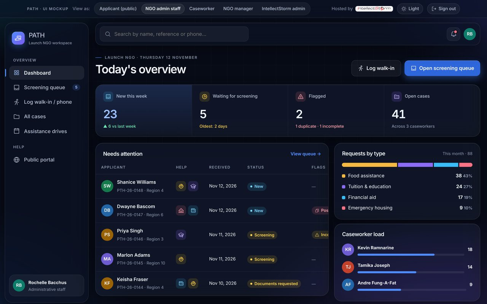

## Try it

Start on the **sign-in page** and tap any **test account** to sign in automatically (staff accounts go through a two-step login with the code `482917`). Password for every test account: `Demo@2026`. Once inside, the **"View as"** bar at the top switches between roles, and the sun/moon button switches light and dark mode.

| View | What you can try |
| --- | --- |
| Applicant (public) | Home page, 4-step application with inline error messages, confirmation with SMS preview, tracking a request (try `PTH-26-0139`, `PTH-26-0144`), choosing how to be contacted, assistance drives by region |
| NGO admin staff | Dashboard, screening queue with duplicate and incomplete flags, assigning a caseworker, logging walk-in and phone requests, planning drives (create, edit, cancel, registrations against capacity) |
| Caseworker | Only their assigned cases, case notes, communication log (including a failed SMS with **Retry**), recurring tuition support, ID number hidden until revealed (recorded in the audit log) |
| NGO manager | All cases, reports by month, type of help, region and status |
| IntellectStorm admin | Switch between NGOs, a second-NGO onboarding preview (phase 2), users and roles, audit log with user/type/search filters, system health and backups |

Things worth trying: search from the top bar (try `Singh` or `zzz`), switch your browser offline to see the offline banner, and use the site with only the keyboard (there's a skip link, visible focus rings and keyboard-openable rows).

## Screens

| Public | Staff |
| --- | --- |
| 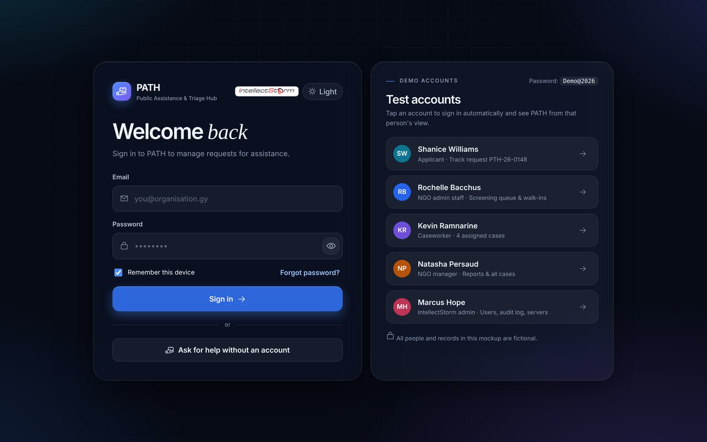 | 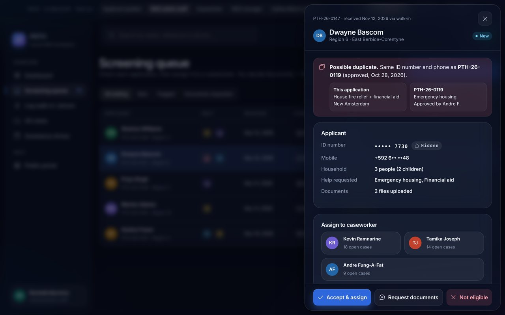 |
| 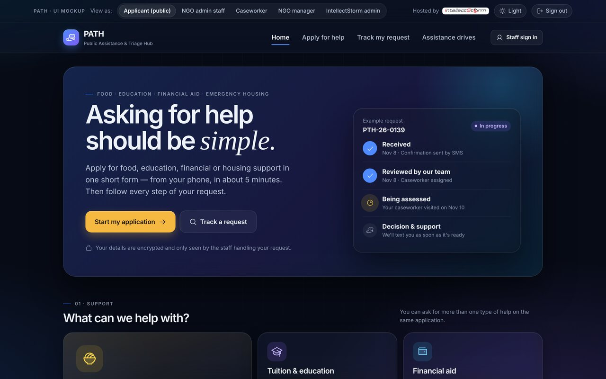 | 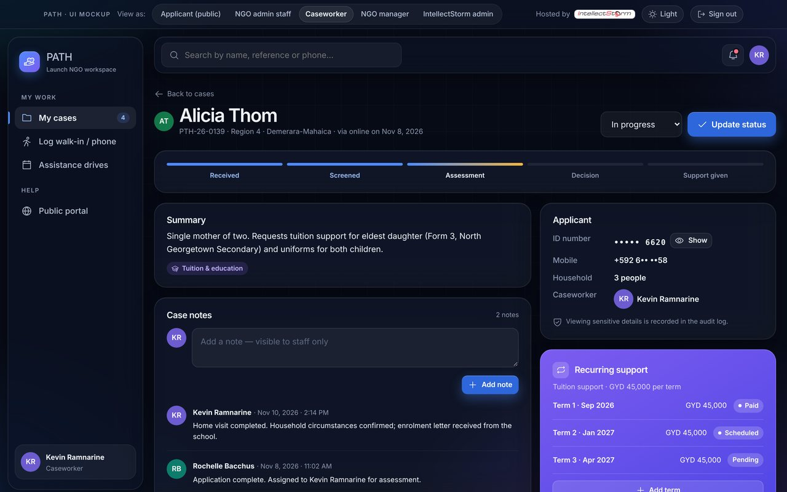 |
| 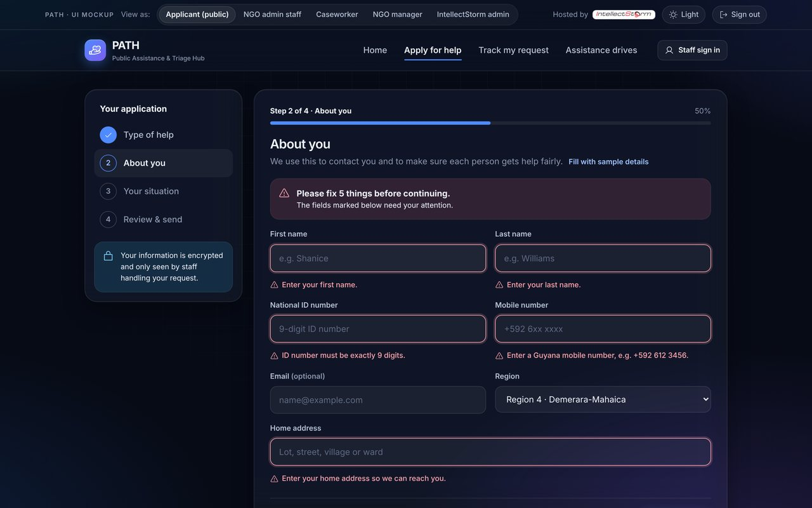 | 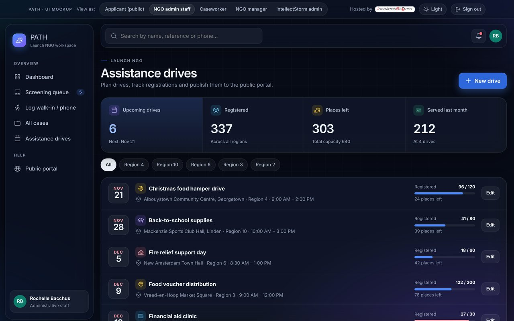 |
| 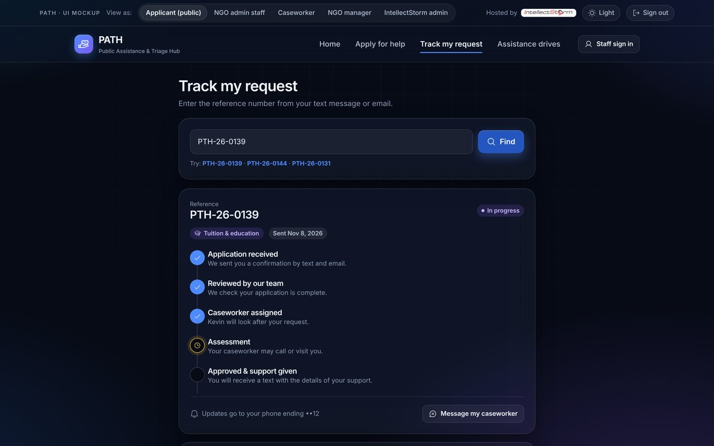 | 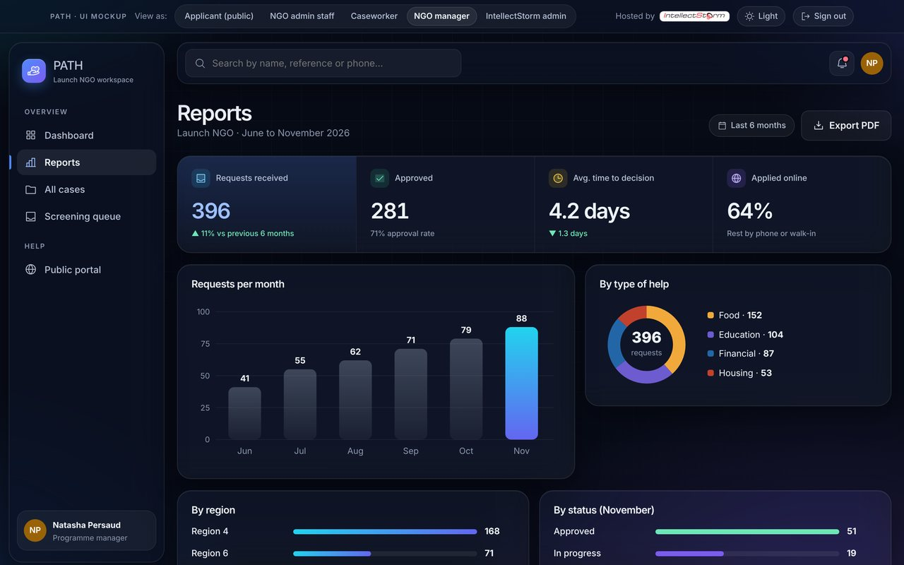 |
| 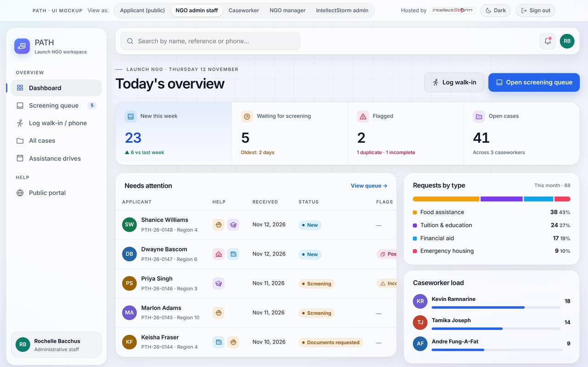 | 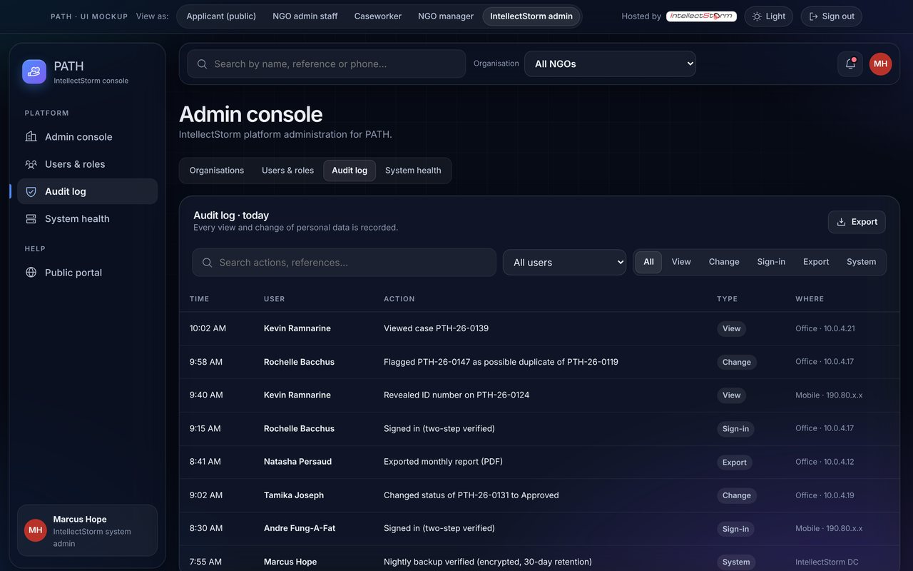 |

On a phone:

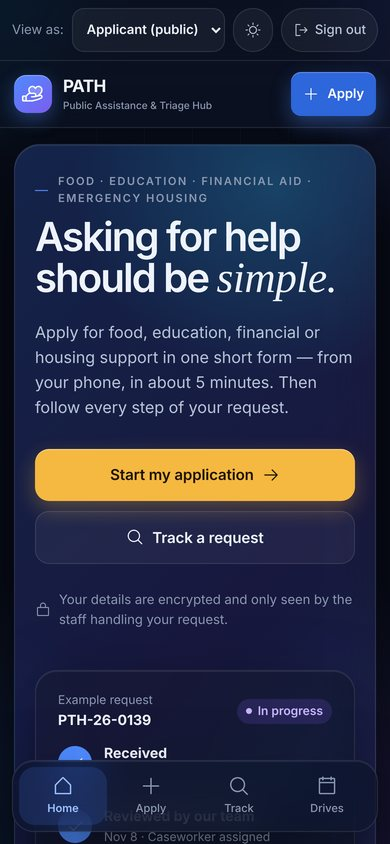
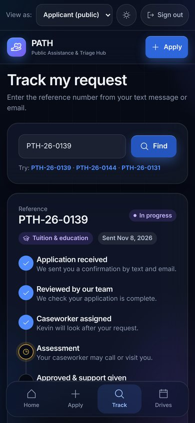
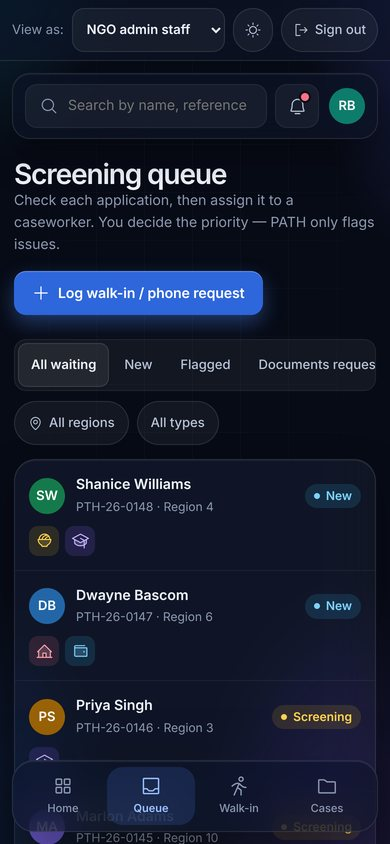

## Quality

- **Accessibility:** no WCAG 2 A/AA issues found by axe-core on any screen in light or dark mode; 44px touch targets on phones; labelled form fields with error messages read out by screen readers; respects "reduce motion".
- **Lighthouse (mobile):** Performance 99 · Accessibility 100 · Best practices 100 · SEO 100.
- **States:** empty results, loading skeletons, offline banner, failed SMS with retry.

## About

This is a static mockup for CSE 2101 Software Engineering (University of Guyana). All names, numbers and records are fictional, and nothing you enter leaves your browser.

Built with plain HTML, CSS and JavaScript — no frameworks and no build step. Phosphor icons, Geist and Instrument Serif fonts. Open `index.html` to run it locally, or serve the folder with any static server.
